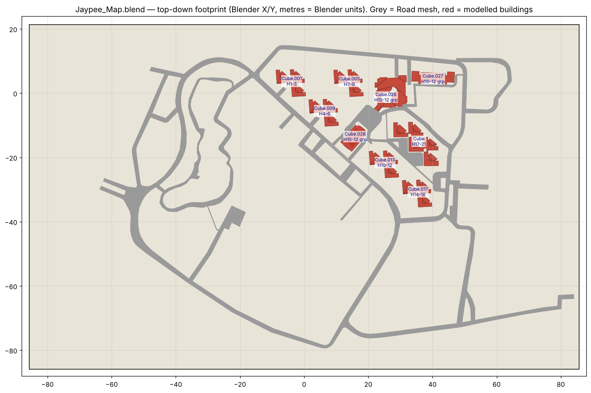
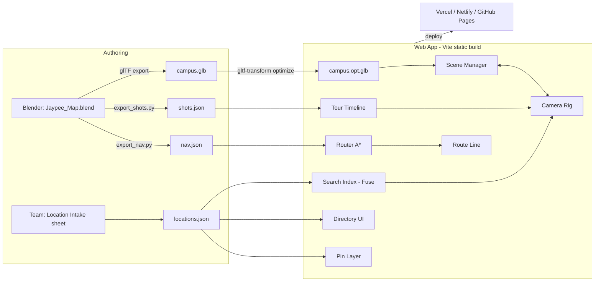
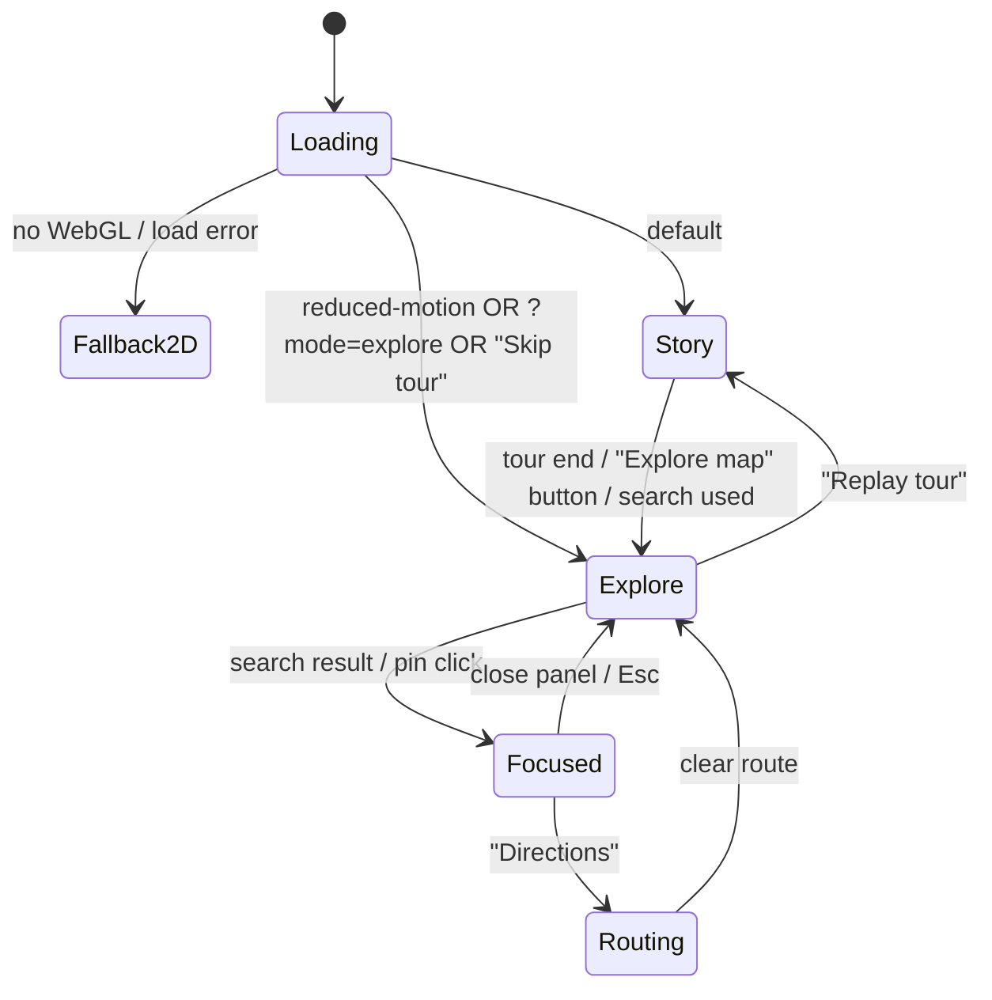

# 👻 Ghost Guide — JUET Campus Accessibility & Facility Map
### Architecture & Build Plan (PS14) — Three.js scroll-driven 3D campus tour + searchable facility directory

> **Campus:** Jaypee University of Engineering & Technology (JUET), A‑B Road, Raghogarh, Guna (M.P.) 473226 · approx. 24.4353° N, 77.1609° E · ~122.5 acres
> **Source model:** `Jaypee_Map.blend` (unfinished — audited in §2)
> **Plan date:** 30 Oct 2026

---

## 0. TL;DR

> ### ⚠️ Hard requirement: the website is built in **three.js**
> - Rendering, camera, models, pins, picking, route lines and the scroll tour all run on **three.js** (`npm i three`, vanilla three.js, not React Three Fiber, Babylon, or a map SDK).
> - The other libraries only *support* three.js: **GSAP/ScrollTrigger + Lenis** turn scroll into a number that three.js reads, and **Fuse.js** handles text search. None of them render anything.
> - three.js modules used: `WebGLRenderer`, `PerspectiveCamera`, `GLTFLoader` + `MeshoptDecoder` (+ `KTX2Loader`), `CatmullRomCurve3`, `MapControls`, `CSS2DRenderer` (HTML pins), `Raycaster`, `InstancedMesh`, `TubeGeometry`/`Line2`, `Fog`, `HemisphereLight`/`DirectionalLight`, `Timer`, `MathUtils.damp`.
> - The plain-HTML directory and the no-WebGL fallback (§9.4) exist only for screen readers and broken devices. The main experience is always the three.js scene.

1. **Two modes, one 3D scene.**
   - **Story mode (scroll tour):** as the user scrolls, the camera flies along a path through the campus and stops at each key location. A text card explains each one (what it is, what's inside, accessibility notes).
   - **Explore mode (the actual PS14 tool):** a free-orbit map with **search**, a **building/room directory**, **map pins**, **filter layers** (washrooms, water, ramps, lifts, accessible entrances) and **walking directions**, including an "accessible route only" option.
2. **Stack:** **three.js (r18x) as the core engine** · Vite + vanilla JS (ES modules) · GSAP + ScrollTrigger · Lenis smooth scroll · Fuse.js fuzzy search. Static hosting, no backend.
3. **Data-driven:** every location lives in a single `locations.json`. Camera "shots" are authored in Blender as empties and exported with a script. Adding a location means adding JSON plus 2 empties, with no code changes.
4. **Accessibility first:** with `prefers-reduced-motion`, a "Skip 3D tour" link, a fully keyboard-usable HTML directory and a 2D fallback map, the site works even if WebGL or animation is off.

---

## 1. Goals & judging alignment

| PS14 requirement | How Ghost Guide delivers it |
|---|---|
| Search for campus facilities | Global search bar (Fuse.js, typo-tolerant, aliases such as "LT1", "mess", "Annapurna"). Selecting a result flies the camera there and highlights the building. |
| Building & room directory | `/directory` section: an HTML accordion by building → floor → rooms, with filter chips. Each entry has a "Show on map" button. |
| Map pins or directions | HTML pins (CSS2DRenderer) per category, plus A* routing on a hand-authored footpath graph with an animated route line. |
| Accessibility information | Per-building panel showing ramps, lifts, accessible washrooms, step-free entrances, drinking water, seating. An "Accessible route" toggle avoids edges marked as stairs. |
| HTML/CSS/JS + campus layout | Plain HTML/CSS/JS and three.js with your own campus model. |
| **Wow factor** | Cinematic scroll tour over a custom 3D JUET model. |

**Non-goals for v1:** indoor 3D floor plans, user accounts, live occupancy, a backend CMS.

---

## 2. Audit of `Jaypee_Map.blend` (what exists today)

Inspected with Blender's Python API (`bpy`). Summary:

| Item | Finding | Action needed |
|---|---|---|
| Objects | 34 total: 31 meshes, 1 light, 1 empty, 0 cameras | — |
| Polycount | **~1,965 faces** total (very light; great for web) | Fine. You can afford 50–150k tris more. |
| Units | Metric, scale 1.0, but **not real-world scale**: map plane is 171 × 107 units, so roughly **1 unit ≈ 7–9 m** | Calibrate (see §2.2) |
| Satellite texture | `fulloverview.png` is **linked from `../../Downloads/`, not packed**. The image is missing in the file I received. | Send me the image, or *File → External Data → Pack Resources* |
| Materials | Only 2 (`Material.001` = ground image, `Material.002`); most buildings have **no material** | Create a small palette (see §8.3) |
| Naming | Generic (`Cube`, `Cube.001` … `Cube.028`) | Rename with the `LOC_` / `BLD_` convention (§8.1) |
| Collections | `Hostel_Boys_H1,2,3`, `H4,5,6`, `H7,8,9`, `H10,11,12`, `H14,15,16`, `H17,18,19,20,21`, `Main` | Good start. Note: **no H13**, and `Cube.026/027/028` sit in the H10–12 collection but look like Annapurna and other non-hostel buildings. |
| Boolean cutters | `Cube.002–.025` (6 verts / 4 faces, tall thin boxes) are **boolean cutter objects** that carve the Y-shaped hostel wings | **Apply** booleans, then **delete** the cutters before export |
| Odd transforms | `Plane` has **negative scale** (−85.6, −53.6, −33.3), so normals are flipped; `Cube` has scale 3.53 and `Cube.026` has scale 2.91 | *Apply → All Transforms*, then *Mesh → Normals → Recalculate Outside* |
| Road | Single mesh `Road` (2,192 verts) covering the entire campus loop | Keep. Optionally split into `ROAD_main` / `PATH_*`. |
| Not yet modelled | Academic blocks, LTs, library/LRC, admin, Tagore Hall, girls' hostel, faculty residences, sports grounds, gates, helipad pad, lake surface | See §10 (Location Intake) |

### 2.1 Current footprint (top-down, Blender X/Y)



*Grey is the `Road` mesh and red is the modelled buildings. Labels show the object name and the collection it belongs to.*

### 2.2 Real-world calibration (recommended)
Pick **3 points** you can identify both in Google Earth and in Blender (for example the main-gate roundabout centre, the helipad centre and the Annapurna centre). Record `(lat, lng)` and `(x, y)` for each. A 2D affine transform fitted from these 3 pairs lets us:
- convert real GPS to model coordinates (enables a "📍 You are here" feature, §6.6), and
- show real distances and walking times ("Annapurna → LT‑1: 450 m, ~6 min").

---

## 3. Research summary — how 3D scroll sites are built (2026)

| Topic | Finding | Decision |
|---|---|---|
| Scroll engine | GSAP ScrollTrigger is the standard tool for scroll-driven animation. Since Webflow acquired GreenSock (Apr 2025), **all GSAP plugins are free**, including commercial use (ScrollSmoother, SplitText, CustomEase…). | ✅ GSAP 3.x + ScrollTrigger |
| Smooth scroll | **Lenis** wraps *native* scroll, so `position: sticky`, anchors and accessibility still work. It is designed to drive WebGL + ScrollTrigger from one loop. Recipe: `lenis.on('scroll', ScrollTrigger.update)` + `gsap.ticker.add(t => lenis.raf(t*1000))` + `gsap.ticker.lagSmoothing(0)`. | ✅ Lenis (desktop). Native scroll on touch. |
| Camera motion | Two proven patterns: **(A)** animate a camera in Blender, export it in the glTF, and scrub `AnimationMixer.setTime(duration × progress)` from ScrollTrigger; **(B)** export path points from Blender, rebuild a `THREE.CatmullRomCurve3` and sample `getPointAt(t)` / `getTangentAt(t)`. Fewer control points means less jitter, and scroll input must be smoothed. | ✅ **B (data-driven shots)**, with A optional for a cinematic intro |
| Blender → three axes | Blender is Z-up and three.js is Y-up: `three = (x, z, -y)`. The glTF exporter converts meshes automatically, but **custom JSON exports must remap manually**. | ✅ Handled in the export script (§8.4) |
| Asset size | Optimise order: textures first (cap at 2048, WebP for download size or KTX2 for GPU memory), then quantise and compress geometry. **Meshopt** decodes much faster than Draco with a smaller decoder. One command: `gltf-transform optimize in.glb out.glb --texture-compress webp`. | ✅ gltf-transform, Meshopt + WebP (KTX2 if phones stutter) |
| three.js version | r183 (Feb 2026) renamed `PostProcessing` to `RenderPipeline` and deprecated `Clock` in favour of `Timer`. r186 shipped Sept 2026. WebGPU is production-ready via `three/webgpu`. | ✅ Pin to latest r18x, **use `WebGLRenderer`** (widest phone support), `THREE.Timer` |
| Responsive & reduced motion | `gsap.matchMedia()` runs setup per media query (desktop / mobile / `prefers-reduced-motion`) and auto-reverts. WCAG 2.3.3 asks that scroll-linked motion be disabled when the user requests reduced motion. | ✅ Mandatory |
| Search | **Fuse.js**: zero-dependency fuzzy search, ~8.6 kB gzip, typo-tolerant, weighted keys, token search. | ✅ Fuse.js |

---

## 4. System architecture

### 4.1 High-level



### 4.2 Runtime state machine



**Only one controller owns the camera at a time.** The `CameraRig` holds a single `mode` flag (`story | explore | flyto`). ScrollTrigger callbacks are ignored unless `mode === 'story'`, and MapControls are disabled unless `mode === 'explore'`. This prevents the classic bug where scroll and orbit fight over the camera.

### 4.3 Page layout (single page, sections)

```
┌───────────────────────────────────────────────┐
│  <header> logo · search · [Tour|Explore] · A11y│  ← fixed
├───────────────────────────────────────────────┤
│  <canvas id="webgl">  position: fixed; inset:0 │  ← always behind
│                                               │
│  <main id="tour">  (scrollable, ~1400vh)       │
│    section.hero          100vh                 │
│    section.chapter × N   ~120vh each           │  ← text cards slide in
│    section.outro          80vh  → "Explore"     │
│  </main>                                       │
│                                               │
│  <aside id="panel">  building detail drawer     │  ← Explore mode
│  <section id="directory"> HTML list (SEO/a11y)  │
│  <footer> team · credits · imagery attribution │
└───────────────────────────────────────────────┘
```

---

## 5. Story mode (scroll tour) — detailed design

### 5.1 Proposed chapter order (follows the campus geography)
*Draft only; confirm in §10.*

| # | Chapter | Shot idea | Card content |
|---|---|---|---|
| 0 | **Hero: "Ghost Guide"** | High aerial slow orbit over the whole campus | Title, tagline, "Scroll to explore" / "Skip to map" |
| 1 | **Main Gate (A‑B Road / NH‑46)** | Low pass over the highway, turn into the west roundabout entrance | Entry points, security, visitor parking, accessible drop-off |
| 2 | **Lake of JUET & Helipad** | Glide over the lake, tilt toward the helipad | Landmark, walking loop |
| 3 | **Academic Blocks** | Push in toward the academic core | Departments, LTs, labs, lifts/ramps |
| 4 | **Library / LRC** | Orbit around the building | Hours, reading halls, accessible desks |
| 5 | **Admin & Tagore Hall** | Side reveal | Admissions, accounts, auditorium |
| 6 | **Annapurna (Mess)** | Drop down to the courtyard | Meal timings, water points, ramp entrance |
| 7 | **Boys' Hostels H1–H21** | Long lateral dolly across the Y-shaped blocks | Block numbering, wardens, washrooms |
| 8 | **Girls' Hostel** | — | — |
| 9 | **Sports: handball court, grounds, gym** | Rise and sweep east | Facilities, timings |
| 10 | **Health centre · Bank/ATM · Shops** | Quick hops with pins | Emergency contact |
| 11 | **Faculty Residences ("Accommodation, JUET")** | Wide south shot | — |
| 12 | **Outro → Explore** | Pull back to top-down map view, seamless handoff to MapControls | "Search anything" CTA |

### 5.2 Camera math

Each chapter has a **shot**: `{ pos: Vector3, target: Vector3, fov? }`, exported from Blender empties `CAM_<id>` and `TGT_<id>`.

- `posCurve = new CatmullRomCurve3(shots.map(s => s.pos), false, 'centripetal')`. Centripetal parameterisation avoids loops and overshoot.
- `tgtCurve = new CatmullRomCurve3(shots.map(s => s.target), false, 'centripetal')`.
- Optional "via" points between shots (for example rising over a building rather than clipping through it) go into the pos curve only, tagged `via: true`.

**Travel + hold.** Each chapter's scroll range is split so the user has time to read:

```
chapter local progress p ∈ [0,1]
  0.00–0.45  → travel   (camera moves from shot i-1 to shot i, eased)
  0.45–1.00  → hold     (camera at shot i with a tiny drift/orbit; card fully visible)
```

```js
// scroll progress (0..1) → curve parameter u (0..1), with holds
function progressToU(progress, n /* chapters */) {
  const seg = Math.min(n - 1, Math.floor(progress * n));
  const p   = progress * n - seg;               // local 0..1
  const travel = 0.45;
  const k   = p < travel ? gsap.parseEase('power2.inOut')(p / travel) : 1;
  return (seg - 1 + k) / (n - 1);               // seg 0 = hero hold
}
```

**Per-frame update (not inside the scroll callback):**
```js
// ScrollTrigger only writes a number; the render loop reads it and damps.
state.targetU = progressToU(self.progress, N);
// in tick():
state.u = THREE.MathUtils.damp(state.u, state.targetU, 4, dt);
camera.position.copy(posCurve.getPointAt(clamp01(state.u)));
_lookTarget.copy(tgtCurve.getPointAt(clamp01(state.u)));
camera.lookAt(_lookTarget);
```
Damping in the render loop removes the stutter from irregular wheel and trackpad events, which is the most common complaint on three.js forums.

### 5.3 ScrollTrigger + Lenis wiring
```js
import Lenis from 'lenis';
import gsap from 'gsap';
import { ScrollTrigger } from 'gsap/ScrollTrigger';
gsap.registerPlugin(ScrollTrigger);

const lenis = new Lenis({ lerp: 0.1 });
lenis.on('scroll', ScrollTrigger.update);
gsap.ticker.add(t => lenis.raf(t * 1000));
gsap.ticker.lagSmoothing(0);

const mm = gsap.matchMedia();
mm.add({
  desktop: '(min-width: 800px) and (prefers-reduced-motion: no-preference)',
  mobile:  '(max-width: 799px) and (prefers-reduced-motion: no-preference)',
  reduce:  '(prefers-reduced-motion: reduce)',
}, ({ conditions }) => {
  if (conditions.reduce) { app.enterExplore({ instant: true }); return; }

  ScrollTrigger.create({
    trigger: '#tour', start: 'top top', end: 'bottom bottom',
    onUpdate: self => rig.setStoryProgress(self.progress),
    snap: conditions.desktop ? { snapTo: chapterSnapPoints, duration: 0.6, ease: 'power1.inOut' } : false,
  });

  // per-chapter card animations
  gsap.utils.toArray('.chapter').forEach((el, i) => {
    gsap.timeline({ scrollTrigger: { trigger: el, start: 'top 70%', end: 'bottom 30%', scrub: true } })
      .from(el.querySelector('.card'), { y: 60, autoAlpha: 0 })
      .to(el.querySelector('.card'), { y: -60, autoAlpha: 0 }, '+=1');
    ScrollTrigger.create({ trigger: el, start: 'top center', end: 'bottom center',
      onToggle: s => s.isActive && scene.highlight(chapters[i].locationIds) });
  });
});
```

### 5.4 Scene effects during the tour
- **Highlight:** active buildings get an emissive accent colour while the rest desaturate slightly (one shared uniform `uFocus` via `onBeforeCompile`, which is cheap). Pins for that chapter fade in.
- **Atmosphere:** `scene.fog` adds depth on wide shots. Use a soft hemisphere light + directional "sun" with **baked AO** (from Blender) rather than real-time shadows on mobile.
- **Text:** HTML cards (not WebGL text), so they stay selectable, translatable and readable by screen readers.
- **Optional mascot:** a tiny low-poly **ghost** that floats ~2 units ahead on `posCurve` (at `u + 0.02`) as the "guide". This fits the "Ghost Guide" name and is cheap to build.

### 5.5 Handoff to Explore mode
At the outro (or on clicking "Explore map" or using search):
1. `rig.mode = 'flyto'`, then GSAP tweens camera position and target to the **overview shot** (top-down, ~60° pitch).
2. `lenis.stop()`. `#tour` collapses (`display:none`) and `ScrollTrigger.getAll().forEach(t => t.disable())`.
3. Enable `MapControls` (pan, zoom, rotate) with damping, clamped `minDistance`/`maxDistance`/`maxPolarAngle` and a bounding box so users can't fly off the map.
4. "Replay tour" reverses this: re-enable triggers, `lenis.start()`, `scrollTo(0)`.

---

## 6. Explore mode — the PS14 tool

### 6.1 Search
- Fuse.js index over `locations.json` with keys and weights `name:3, aliases:2.5, rooms.name:2, rooms.code:2, category:1, departments:1.5, tags:1`.
- Search-as-you-type dropdown (max 8 results), grouped by **Buildings / Rooms / Facilities**, with keyboard ↑↓/Enter and an ARIA `combobox`/`listbox` pattern.
- Selecting a result calls `flyTo(location)`, highlights the building, drops a pulsing pin and opens the detail panel.
- Facility queries like "water" or "washroom near library" show *all* matching POIs and sort by distance to the currently focused building.

### 6.2 Building & room directory
- Rendered as real HTML from the same JSON: an accordion **Building → Floor → Rooms**, with filter chips (Lecture Halls, Labs, Washrooms, Water, Accessible Entrance, Lift, Ramp).
- Each row has a "📍 Show on map" button.
- Doubles as the **no-WebGL / screen-reader fallback**.

### 6.3 Pins & layers
- `CSS2DRenderer` HTML pins, so they are focusable `<button>`s with `aria-label`, scale-independent and easy to style.
- Layer toggles: 🏫 Academic · 🛏 Hostels · 🍽 Food · 🚻 Washrooms · 🚰 Water · ♿ Accessible entrances · 🛗 Lifts · ➡ Ramps · ⚕ Medical · 🏧 ATM.
- Zoom-based decluttering: at high zoom only building pins show, and sub-POIs appear as the user zooms in. Use a simple screen-space overlap check (sort by priority and hide overlaps).

### 6.4 Detail panel (per building)
Name · photo · what's inside (departments/rooms by floor) · hours · **Accessibility card** (step-free entrance ✅/❌, ramp location, lift, accessible washroom, nearest water point, notes) · "Directions from…" · "Share link" (`#/loc/annapurna`, deep-linkable).

### 6.5 Directions (walking routes)
- **Nav graph** `nav.json`: nodes are road/path junctions plus building entrances, authored as Blender empties `NAV_###` and `ENT_<locId>_<n>`. Edges are listed explicitly with flags `{ stairs, unpaved, length }`.
- **A\*** in JS (~60 lines, Euclidean heuristic). With **"Accessible route"** on, edges with `stairs:true` are excluded and `unpaved` edges cost ×3.
- Render the route as a `TubeGeometry` (or `Line2`) lifted 0.05 units above the road, with an animated dash shader. The camera frames the route's bounding box.
- Show distance and time: `length × metresPerUnit / 1.2 m/s` (use 0.8 m/s for the wheelchair profile).

### 6.6 Stretch features (if time permits)
- 📍 **You are here:** `navigator.geolocation` combined with the affine transform from §2.2.
- 🌐 **Hindi / English toggle** (all strings live in JSON).
- 🌙 Day/night lighting toggle.
- 📷 Street-level photo for each entrance.
- 🔗 QR codes at real entrances that open `#/loc/<id>`.

---

## 7. Data model

### 7.1 `locations.json` (single source of truth)
```jsonc
{
  "id": "annapurna",                         // = Blender object suffix: LOC_annapurna
  "name": "Annapurna (Central Mess)",
  "aliases": ["mess", "dining", "canteen", "annapurna"],
  "category": "food",                        // academic|hostel|food|admin|sports|medical|service|landmark|gate
  "chapter": 6,                              // null if not in tour
  "blockCode": null,
  "description": "Central dining hall for hostel residents.",
  "hours": "07:30–09:30, 12:30–14:30, 19:30–21:30",
  "floors": [
    { "level": 0, "rooms": [
      { "code": "A-G01", "name": "Dining Hall 1", "type": "dining" },
      { "code": "A-G02", "name": "Washroom (Accessible)", "type": "washroom", "accessible": true }
    ]}
  ],
  "accessibility": {
    "stepFreeEntrance": true,
    "ramp": "North entrance, 1:12 slope",
    "lift": false,
    "accessibleWashroom": true,
    "notes": "Use north entrance; south has 3 steps."
  },
  "pois": [                                  // sub-points rendered as pins
    { "type": "water",    "label": "RO water cooler", "pos": [27.1, 0.0, -1.8] },
    { "type": "entrance", "label": "North entrance (step-free)", "pos": [26.4, 0.0, -6.0], "accessible": true }
  ],
  "anchor": [27.04, 0.0, -0.27],             // three.js coords (x, z_blender, -y_blender)
  "shot": { "pos": [40, 25, 20], "target": [27, 0, -0.3], "fov": 40 },  // filled by export_shots.py
  "photos": ["/img/annapurna-1.webp"],
  "contact": null
}
```

### 7.2 `nav.json`
```jsonc
{ "metresPerUnit": 8.2,
  "nodes": { "n001": [x, y, z], "ent_annapurna_1": [x, y, z] },
  "edges": [ ["n001", "n002", { "stairs": false, "unpaved": false }] ] }
```

### 7.3 `chapters.json`
```jsonc
[{ "id": 6, "title": "Annapurna", "kicker": "Where the campus eats",
   "body": "…", "locationIds": ["annapurna"], "shotId": "annapurna" }]
```

---

## 8. 3D asset pipeline (Blender → web)

### 8.1 Naming convention (required: code depends on it)
| Prefix | Meaning | Example |
|---|---|---|
| `LOC_<id>` | A clickable building/area (mesh or parent empty) | `LOC_annapurna`, `LOC_hostel_h07` |
| `CAM_<id>` / `TGT_<id>` | Camera position / look-at empties for a shot | `CAM_annapurna`, `TGT_annapurna` |
| `VIA_<n>` | Extra camera path control point | `VIA_03` |
| `NAV_<n>` | Footpath graph node | `NAV_017` |
| `ENT_<id>_<n>` | Building entrance (also a nav node) | `ENT_annapurna_1` |
| `POI_<type>_<id>_<n>` | Small facility point | `POI_water_annapurna_1` |
| `ENV_*` | Non-interactive context (trees, ground, road) | `ENV_ground`, `ENV_road` |

### 8.2 Clean-up checklist for the current file
- [ ] Pack or relink `fulloverview.png`, or replace it with a fresh high-res export from Google Earth (keep the **attribution** in the site footer).
- [ ] Select all, then *Object → Apply → All Transforms*, to fix the Plane's negative scale and the 3.53 / 2.91 scales.
- [ ] *Mesh → Normals → Recalculate Outside* on everything.
- [ ] Apply all **Boolean** modifiers on hostel meshes, then delete cutters `Cube.002–.025`.
- [ ] Rename per §8.1; move `Cube.026/027/028` out of the H10–12 collection.
- [ ] Set each building's **origin to the base centre**, which makes highlight, pins and scale animations easier.
- [ ] Add a **ground mesh slightly larger than the map**, fading to a flat colour at the edges so the map doesn't end abruptly in the tour.
- [ ] Model missing buildings (§2), using simple extrusions of the satellite footprints. Aim for low-poly, clean, consistent roof height per floor (≈ 0.4 unit / floor at the current scale).
- [ ] Optional: **bake AO + soft sun shadow** into a lightmap (Cycles bake) for a premium look at zero runtime cost.

### 8.3 Visual style (suggested)
Stylised "architectural model" look: off-white buildings (`#EDEBE6`), roads `#9A9A9A`, satellite ground slightly desaturated and darkened (so buildings pop), accent colour for highlight `#7C5CFF` (ghost purple). Category colours for pins only.

### 8.4 `export_shots.py` (run inside Blender)
```python
import bpy, json
out = {}
def to_three(v):  # Blender Z-up -> three.js Y-up
    return [round(v.x, 3), round(v.z, 3), round(-v.y, 3)]
for o in bpy.data.objects:
    if o.name.startswith("CAM_"):
        sid = o.name[4:]
        tgt = bpy.data.objects.get("TGT_" + sid)
        out[sid] = {"pos": to_three(o.matrix_world.translation),
                    "target": to_three(tgt.matrix_world.translation) if tgt else None}
    elif o.name.startswith(("LOC_", "ENT_", "POI_", "NAV_", "VIA_")):
        out.setdefault("_anchors", {})[o.name] = to_three(o.matrix_world.translation)
json.dump(out, open(bpy.path.abspath("//shots.json"), "w"), indent=1)
print("exported", len(out), "shots")
```
*Tip:* in Blender, select `CAM_x` and *Add → Camera* temporarily with a "Track To" constraint on `TGT_x` to preview exactly what the web camera will see.

### 8.5 Export & optimise
1. *File → Export → glTF 2.0 (.glb)*: **+Y Up** ✅, Apply Modifiers ✅, include **Custom Properties** ✅ (for `locId` tags), Cameras ❌, Lights ❌, Selected/Visible only ✅ (to exclude empties used only for data).
2. `npx @gltf-transform/cli optimize campus.glb public/models/campus.opt.glb --compress meshopt --texture-compress webp --texture-size 2048`
3. `npx @gltf-transform/cli inspect public/models/campus.opt.glb` gives a target of **≤ 4 MB total** (ground texture is the biggest part).
4. If phones stutter or run out of memory, switch to `--texture-compress ktx2` and add `KTX2Loader`.

---

## 9. Front-end code architecture

### 9.1 Folder structure
```
ghost-guide/
├─ index.html
├─ vite.config.js
├─ public/
│  ├─ models/campus.opt.glb
│  ├─ data/ locations.json · chapters.json · nav.json · shots.json
│  ├─ img/ (webp photos)
│  └─ fallback/campus-2d.webp          # static map for no-WebGL
├─ src/
│  ├─ main.js                          # boot: capability check → load → mode
│  ├─ core/
│  │  ├─ Renderer.js                   # WebGLRenderer, resize, DPR cap, render-on-demand
│  │  ├─ SceneManager.js               # load glb, index LOC_ meshes, materials, highlight
│  │  ├─ CameraRig.js                  # single owner of camera; modes story|explore|flyto
│  │  ├─ Loop.js                       # gsap.ticker-driven tick(dt), THREE.Timer
│  │  └─ Assets.js                     # GLTFLoader + MeshoptDecoder (+KTX2Loader)
│  ├─ story/
│  │  ├─ ScrollEngine.js               # Lenis + ScrollTrigger + matchMedia
│  │  ├─ TourPath.js                   # CatmullRom curves, progressToU, holds
│  │  └─ Chapters.js                   # build <section>s from chapters.json, card anims
│  ├─ explore/
│  │  ├─ MapControlsCtl.js             # MapControls, bounds, damping
│  │  ├─ Pins.js                       # CSS2DRenderer, layers, declutter
│  │  ├─ Picking.js                    # raycast hover/click on LOC_ meshes
│  │  ├─ Router.js                     # A* over nav.json
│  │  └─ RouteLine.js                  # tube + dash shader
│  ├─ ui/
│  │  ├─ Search.js                     # Fuse index, combobox a11y
│  │  ├─ Directory.js                  # accordion + filters
│  │  ├─ Panel.js                      # detail drawer
│  │  ├─ Loader.js                     # progress bar, "Skip 3D"
│  │  └─ A11yMenu.js                   # reduce motion, high contrast, text size
│  ├─ data/store.js                    # fetch + merge JSON, derived indexes
│  ├─ utils/ math.js · events.js (tiny pub/sub) · url.js (hash routing)
│  └─ styles/ base.css · tour.css · explore.css · a11y.css
└─ tools/
   ├─ export_shots.py
   ├─ export_nav.py
   └─ validate-data.mjs               # checks every LOC_ in glb has a JSON entry & vice-versa
```

### 9.2 Module communication
A tiny event bus keeps modules decoupled:
```
search:select(locId) → CameraRig.flyTo, SceneManager.highlight, Panel.open, url.set
pin:click(locId)     → same as above
route:request(from,to,accessible) → Router → RouteLine.show → CameraRig.frame(bbox)
mode:change(story|explore)
```

### 9.3 Performance budget
| Metric | Target |
|---|---|
| First load (gzip) | JS ≤ 250 kB, GLB ≤ 4 MB |
| Time to first interactive frame | < 3 s on 4G mid-range Android |
| FPS | 60 desktop, ≥ 40 mid-range phone |
| Draw calls | < 80 (merge static ENV meshes; **InstancedMesh** for repeated hostel blocks and trees) |

Techniques: `renderer.setPixelRatio(Math.min(devicePixelRatio, 1.75))` · **render-on-demand** in Explore mode (only render when controls change or tweens run) · pause the loop on `visibilitychange` · `frustumCulled` true · no real-time shadows on mobile (baked instead) · lazy-load photos · preload GLB with `<link rel="preload">`.

### 9.4 Device & fallback strategy
| Condition | Behaviour |
|---|---|
| No WebGL / GLB fails | Static 2D map image + HTML pins (absolute %) + full directory and search |
| `prefers-reduced-motion` | Skip tour; Explore mode with **instant** camera cuts (no fly-tos) |
| Low-end (`deviceMemory ≤ 4` or slow first frames) | DPR 1, no fog, no mascot, simpler materials |
| Touch | Native scroll (no Lenis smoothing), no snap, bigger hit targets (≥ 44 px) |

---

## 10. 📋 Location Intake (please fill this in)

I need these details to finish the data and the tour. **Pre-filled rows are my best guess** from the satellite labels and public sources. Please correct them.

### 10.1 Master list of locations
| id | Name (official) | Also called | Category | In tour? | Floors | Modelled? |
|---|---|---|---|---|---|---|
| `main_gate` | Main Gate (A‑B Road) | — | gate | ✅ | — | ❌ |
| `lake` | Lake of JUET | — | landmark | ✅ | — | texture only |
| `helipad` | JUET Helipad | — | landmark | ✅ | — | ❌ |
| `annapurna` | Annapurna (Mess) | mess | food | ✅ | ? | ✅ (`Cube.026`?) |
| `civil_dept` | Department of Civil Engineering | — | academic | ? | ? | ❌ |
| `handball` | Handball Court | — | sports | ✅ | — | ❌ |
| `faculty_res` | Accommodation, JUET (faculty residences) | — | residential | ✅ | ? | ❌ |
| `hostel_h01…h21` | Boys' Hostels H1–H21 (no H13?) | — | hostel | ✅ | ? | ✅ |
| `girls_hostel` | Girls' Hostel | — | hostel | ✅ | ? | ❌ |
| `tagore_hall` | Tagore Hall | — | admin/events | ✅ | ? | ❌ |
| `acad_?` | Academic Block(s) — names/letters? | — | academic | ✅ | ? | ❌ |
| `library` | Library / LRC | — | academic | ✅ | ? | ❌ |
| `admin` | Admin Block | — | admin | ✅ | ? | ❌ |
| `?` | `Cube.027` (long rectangle, north-east) — what is it? | | | | | ✅ |
| `?` | `Cube.028` (triangular/diamond, centre) — what is it? | | | | | ✅ |
| … | Health centre, bank/ATM, shops, gym, sports ground, workshop, parking, guest house, temple? | | | | | |

### 10.2 Per-building details (one block per building)
```
Building:
  Official name / short code:
  Departments or uses inside:
  Floors (G, 1, 2…):
  Key rooms per floor (LT numbers, lab names, room codes):
  Washrooms (which floors, gents/ladies/accessible):
  Drinking-water points (where exactly):
  Entrances (how many; which are step-free; ramp yes/no):
  Lift? (yes/no, location):
  Opening hours:
  1–2 photos (exterior + entrance):
  Anything a new student always gets lost finding here?
```

### 10.3 Campus-level questions
1. **Hostel numbering:** your collections go up to H21 with no H13, while public sources say "20 boys' hostel blocks". Is H13 skipped intentionally? Which physical Y-block maps to which H-number?
2. **Academic blocks:** how many are there, and what are they called (A/B/C? JBS?)? Where are the LTs and labs?
3. **Which gate(s)** do visitors actually use? Is there a separate gate on the south side?
4. **Footpaths:** are there walkways not visible on the satellite image (covered corridors, shortcuts across grounds)? Any stairs-only routes?
5. **Accessibility reality check:** which buildings have *no* step-free entrance today? Where are accessible washrooms?
6. **Tour order & length:** happy with the 12 chapters in §5.1, or should some be cut or merged? (Target: ~90 s scroll for the whole tour.)
7. **Branding:** may we use the JUET logo and colours, or should Ghost Guide have its own identity?
8. **Deadline & team size:** when is the demo, and how many people work on it (3D / front-end / data)?

---

## 11. Build phases & task split

| Phase | Deliverable | Owner |
|---|---|---|
| **P0 — Setup** (½ day) | Vite repo, folder skeleton, deploy pipeline (Vercel preview per push), dummy cube scene | Front-end |
| **P1 — Asset v1** (1–2 days) | Clean-up checklist §8.2, renamed objects, texture packed, first optimised GLB | 3D |
| **P2 — Data v1** (parallel) | Location Intake filled, `locations.json` for ≥ 15 locations, photos | Data/content |
| **P3 — Explore MVP** (2 days) | Load GLB, MapControls, picking, pins, search, detail panel, directory | Front-end |
| **P4 — Story mode** (2 days) | Shots in Blender → `shots.json`, TourPath, ScrollEngine, chapter cards, handoff | Front-end + 3D |
| **P5 — Directions** (1 day) | Nav graph in Blender, A*, route line, accessible toggle | Front-end + 3D |
| **P6 — A11y & perf pass** (1 day) | Reduced motion, keyboard, fallback, Lighthouse ≥ 90 a11y, phone testing | All |
| **P7 — Polish** (rest) | Mascot ghost, lighting bake, transitions, Hindi toggle, QR codes | All |

**MVP cut line** (if time is short): P0–P3 plus a 5-chapter tour already satisfies every PS14 requirement and still includes the scroll animation.

---

## 12. Risks & mitigations

| Risk | Mitigation |
|---|---|
| Scroll and orbit fight over the camera | Single `CameraRig` owner with a mode flag (§4.2) |
| Jittery camera on trackpads | Damp in the render loop; centripetal Catmull-Rom; few control points |
| Camera clips through buildings | `VIA_` points; preview every shot in Blender with a temporary camera |
| Satellite texture too large / blurry | 2048–4096 WebP; crop to campus bounds; desaturate; KTX2 if needed |
| Inaccurate facility data | `validate-data.mjs` + "Report an issue" link (mailto / Google Form) |
| Mobile performance | DPR cap, render-on-demand, baked lighting, low-tier mode |
| Scroll-jacking annoys users | Always-visible "Skip tour" and "Explore map"; native scroll on touch; reduced-motion respected |
| Map imagery licensing | Keep Google/Airbus attribution visible in the footer, or trace footprints and use a stylised ground instead of raw imagery for the public site |

---

## 13. Definition of done (demo checklist)
- [ ] Scroll tour runs smoothly at 60 fps on a laptop and ≥ 40 fps on a mid-range phone
- [ ] Typing "mess", "LT 3", "water" or "washroom" returns correct results and flies there
- [ ] Every building has an accessibility card
- [ ] A route with **"Accessible only"** avoids stairs edges
- [ ] Works with keyboard only; works with reduced motion; works with WebGL disabled
- [ ] Deep link `…/#/loc/annapurna` opens focused on Annapurna
- [ ] Lighthouse: Performance ≥ 80 (mobile), Accessibility ≥ 95

---

## 14. References
- GSAP ScrollTrigger & free plugins: https://github.com/greensock/GSAP · https://gsap.com/docs/v3/GSAP/gsap.matchMedia()
- Codrops, *How to Build Cinematic 3D Scroll Experiences with GSAP* (Nov 2025): https://tympanus.net/codrops/2025/11/19/how-to-build-cinematic-3d-scroll-experiences-with-gsap/
- Codrops, *Scroll-Driven 3D Gallery Using a Blender Camera Path with Three.js and GSAP* (Jul 2026): https://tympanus.net/codrops/2026/07/07/building-a-scroll-driven-3d-gallery-using-a-blender-camera-path-with-three-js-and-gsap/
- Lenis smooth scroll: https://github.com/darkroomengineering/lenis
- Scrubbing Blender glTF animation with GSAP (forum): https://discourse.threejs.org/t/how-to-control-animation-made-in-blender-gltf-using-three-js-gsap/27319
- Smooth camera on CatmullRomCurve3 (forum): https://discourse.threejs.org/t/any-advice-updating-camera-position-smoothly-along-catmullromcurve3/6083
- GLB optimisation (Draco vs Meshopt vs KTX2, 2026): https://app.cinevva.com/guides/optimize-glb-for-web
- Fuse.js: https://www.fusejs.io
- WCAG 2.3.3 Animation from Interactions: https://www.disabilityworld.org/toolkit/standards/wcag/2-3-3-animation-from-interactions/
- JUET Annual Report 2023‑24 (campus description): https://juet.ac.in/jaypee/images/Images-1/AnnualReport2023-24.pdf
