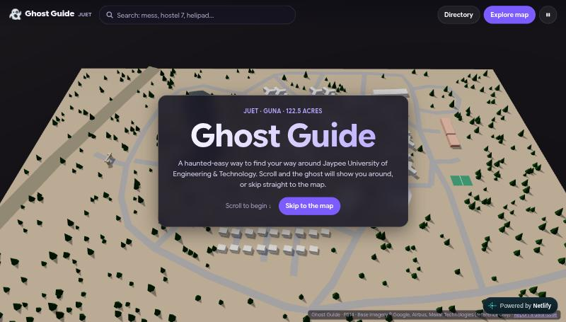
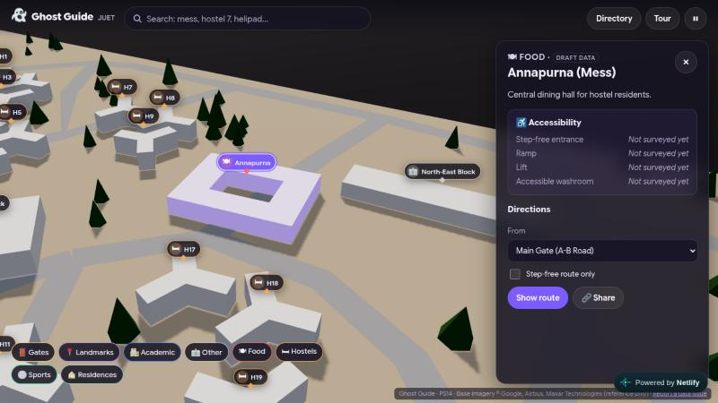

<div align="center">

# 👻 Ghost Guide

**A 3D campus tour and accessibility-first facility map for JUET, Guna**

### 🌐 Live: **[ghost-guide-juet.netlify.app](https://ghost-guide-juet.netlify.app)**

[Take the tour](https://ghost-guide-juet.netlify.app) · [Open the map](https://ghost-guide-juet.netlify.app/?mode=explore) · [Example deep link](https://ghost-guide-juet.netlify.app/#/loc/annapurna)


</div>



Ghost Guide is our project for **PS14 (Campus Accessibility & Facility Map)**. It answers the questions a new student, visitor or wheelchair user has on the Jaypee University of Engineering & Technology campus: *where is it, how do I get there, and can I get in without steps?*

The site has two modes, both running on the same three.js scene:

| 🎬 Story mode | 🗺️ Explore mode |
|---|---|
| Scroll and the camera flies through the campus, stopping at 9 key places with a short card for each. A little ghost guide floats along with you. | A free 3D map with search, pins, layer filters, a building directory, detail panels with accessibility info, and walking directions. |



---

## ✨ Features

- **🔎 Search anything:** typo-tolerant search with aliases. `mess`, `annapurna`, `H7`, `hostel 12`, `gate` and `helipad` all work. Press <kbd>/</kbd> to jump to the search box.
- **📍 Map pins and layers:** pins that hide automatically when they overlap, plus toggles for Academic, Hostels, Food, Sports, Landmarks, Gates and Residences.
- **🏢 Building directory:** a full HTML list grouped by category and filterable, with a "Show on map" button for every entry.
- **♿ Accessibility card:** every building shows step-free entrance, ramp, lift and accessible-washroom status.
- **🧭 Walking directions:** A* routing over a campus footpath graph, drawn as an animated route line with distance and walking time. **Step-free route only** avoids paths with stairs.
- **🔗 Shareable links:** `#/loc/<id>` opens the map focused on that building.
- **🎥 Smooth scroll tour:** a GSAP ScrollTrigger and Lenis tour along Catmull-Rom camera curves, with a "hold" at each stop so you have time to read.
- **🫶 Inclusive by default:**
  - respects `prefers-reduced-motion` and has its own reduce-motion toggle
  - fully keyboard-usable, with a skip link straight to the directory
  - shows a 2D fallback map when WebGL isn't available
  - adapts the layout for phones

## 🧱 Tech stack

| Layer | Tools |
|---|---|
| 3D engine | **three.js** (WebGLRenderer, MapControls, CSS2DRenderer, GLTFLoader + Meshopt, InstancedMesh) |
| Scroll | GSAP ScrollTrigger + Lenis |
| Search | Fuse.js |
| Build | Vite, vanilla JS (ES modules), no framework |
| Hosting | Netlify (static, no backend) |

## 🚀 Run it locally

```bash
git clone https://github.com/Rohil-Soni/Ghost-Guide.git
cd Ghost-Guide
npm install
npm run dev        # http://localhost:5173
```

| Command | What it does |
|---|---|
| `npm run dev` | Dev server with hot reload |
| `npm run build` | Production build into `dist/` |
| `npm run preview` | Serve the production build locally |
| `npm run validate` | Cross-check locations, chapters, the nav graph and the 3D model names |
| `npm run optimize` | Compress `campus.glb` into `public/models/campus.opt.glb` (Meshopt + WebP) |

Useful URLs: `/?mode=explore` skips the tour, and `/#/loc/<id>` opens a building (for example `#/loc/hostel_h07`).

## 📁 Project structure

```
Ghost-Guide/
├─ index.html
├─ netlify.toml               # Netlify build + cache headers
├─ public/data/
│  ├─ locations.json          # every building: names, aliases, rooms, accessibility, position
│  ├─ chapters.json           # tour chapters: text + camera shot
│  ├─ nav.json                # walking graph: nodes, edges, stairs/unpaved flags
│  └─ shots.json              # optional camera shots exported from Blender
├─ src/
│  ├─ main.js                 # boot, mode switching, wiring
│  ├─ core/                   # renderer, scene, CameraRig, placeholder campus, loaders
│  ├─ story/                  # TourPath, ScrollEngine, chapter cards, ghost mascot
│  ├─ explore/                # Pins, Picking, Router (A*), RouteLine
│  ├─ ui/                     # Search, Directory, Panel, Loader
│  └─ styles/
├─ tools/
│  ├─ export_shots.py         # Blender → camera shots and anchors
│  ├─ export_nav.py           # Blender → walking graph
│  └─ validate-data.mjs
└─ GHOST_GUIDE_PLAN.md        # full architecture and build plan
```

## ✏️ Updating campus data

All content is data-driven, so **adding or fixing a location needs no code changes**.

1. **Add or edit a building** in `public/data/locations.json`. Use an `id` in `lower_snake_case`. `anchor` is the position in three.js coordinates (`[x, 0, z]`, where `z = -BlenderY`).
2. **Accessibility** fields take `true`, `false`, a short description, or `null`. `null` shows as "Not surveyed yet".
3. **Add a tour stop** in `public/data/chapters.json`, listing the `locationIds` it covers.
4. **Paths** go in `public/data/nav.json`. Add `{"stairs": true}` or `{"unpaved": true}` to an edge so step-free routing avoids it or penalises it.
5. Run `npm run validate`, then commit and push.

Researched place data lives in `data-sources/juet_campus_dataset/`. After updating it, run `node tools/import-juet-dataset.mjs` to merge it into `locations.json`. The importer keeps map positions and fills in names, aliases, where-to-find notes, nearby links and source citations. Places without coordinates are listed and searchable, but get no pin until their position is captured.

## 🧊 Using the real Blender model

The site currently shows a **procedural stand-in campus** (`src/core/ProceduralCampus.js`), traced from the top-down footprint of `Jaypee_Map.blend`. Once a real model is exported, it is picked up automatically:

1. Name each clickable object `LOC_<id>`, matching `locations.json` (e.g. `LOC_annapurna`, `LOC_hostel_h07`).
2. Export **glTF 2.0 (.glb)** as `campus.glb` in the repo root (+Y up, apply modifiers, no cameras or lights).
3. Run `npm run optimize`, then `npm run validate`.
4. Optional: add `CAM_<id>` / `TGT_<id>` empties and run `tools/export_shots.py` in Blender for custom camera shots.

## 🌍 Deployment

The site is hosted on **Netlify** at **https://ghost-guide-juet.netlify.app**. Build settings live in `netlify.toml` (`npm run build` → `dist/`). To redeploy by hand:

```bash
npm run build
npx netlify-cli deploy --prod --dir dist
```

## 🗺️ Roadmap / data still needed

Entries tagged **draft** on the site are placeholders until the campus survey is done:

- [ ] Hostel block ↔ H-number mapping (JUET lists 21 blocks; the model has 20, with no H13)
- [x] Sourced details for Main Gate, Nehru Plaza, Academic Blocks (Ramanujan, Raman, Vishvesvaraya Bhawan), LT-1, LT-2 to LT-5, LRC, Admin Offices, Tagore Hall/MPH, Sports Ground, Shopping Centre, Annapurna and the Hostel Area ([dataset](data-sources/juet_campus_dataset/README.md))
- [ ] Map positions for Nehru Plaza, Tagore Hall/MPH, Sports Ground, Shopping Centre, Admin Offices, Hostel Area and the girls' hostel (listed and searchable, but no pin yet)
- [ ] Separate pins for LT-1, LT-2…LT-5 and the LRC (currently shown at the Academic Block Area)
- [ ] Health centre, ATM/bank, shops, gym and sports grounds
- [ ] Identify the North-East Block, Central Block and Large Hall
- [ ] Accessibility survey for every building (entrances, ramps, lifts, washrooms, water points)
- [ ] Real stairs/unpaved flags on footpaths (current flags are samples)
- [ ] Real-world scale calibration for accurate distances
- [ ] Replace the placeholder campus with the finished Blender model
- [ ] Stretch: "You are here" GPS, Hindi/English toggle, day/night lighting

## 🙏 Credits

Built by **[Rohil Soni](https://github.com/Rohil-Soni)** for PS14.
Base map imagery used for reference: © Google, Airbus, Maxar Technologies.
